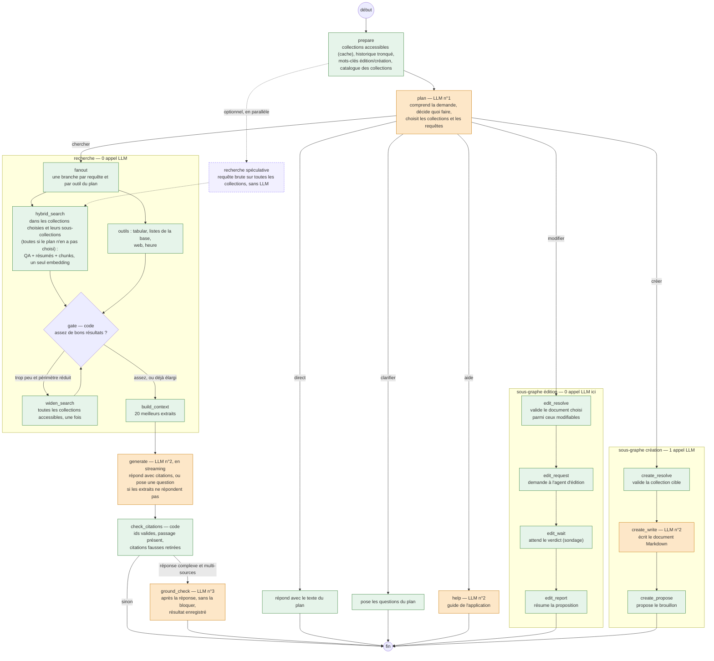

# Proposition : un agent à 1 à 3 appels LLM

Proposition, rien n'est implémenté. Elle part de [l'audit et du graphe actuel](agent-execution-graph.md), qui fait 4 à 5 appels LLM
en série pour une question simple et jusqu'à une dizaine pour une complexe.

## Principes

1. **Un premier appel qui décide de tout.** Il remplace `detect_edit`, `detect_create`, `analyze_query`, `decompose_query`, le choix des
   collections de chaque tâche et le tri entre identité, aide et recherche. Il peut aussi répondre directement.
2. **La recherche ne fait plus appel au LLM.** Elle cherche directement dans les collections que le plan a choisies et dans leurs
   sous-collections, ou dans toutes si le plan n'en a pas choisi. Le « les résumés suffisent-ils ? » et le « les preuves suffisent-elles ? »
   deviennent des règles sur les scores.
3. **Un seul appel pour répondre**, en streaming. Il peut aussi poser une question quand les extraits ne répondent pas, à la place de
   `clarify_coverage`.
4. **Le contrôle des citations passe en code.** Un troisième appel, optionnel et sans blocage, ne vérifie que les réponses complexes.
5. **L'édition et la création sont des sous-graphes** qui ne rouvrent pas la recherche.

## Le graphe

Orange : appel LLM. Vert : code. Violet en pointillés : optionnel.




## Détail des nœuds

| Nœud | Ce qu'il fait | LLM | Autre chose utilisée |
|---|---|---|---|
| `prepare` | Charge les collections accessibles (cache de l'utilisateur, TTL court), tronque l'historique aux derniers tours, teste les mots-clés d'édition et de création. Si un mot-clé correspond, charge aussi les documents modifiables ou les collections cibles. Construit le catalogue (nom, description) ; au-delà d'un seuil, le pré-filtre vectoriel existant garde les plus proches. | 0 | Backend : collections, éventuellement documents modifiables ; Qdrant : pré-filtre |
| `plan` | **L'appel n°1.** Voir le contrat plus bas. | **1** | – |
| `direct` | Renvoie le texte de réponse déjà écrit par le plan (salutation, identité, question qui n'a pas besoin des documents). | 0 | – |
| `ask` | Pose les questions du plan (demande ambiguë, collection indécise) et termine. | 0 | – |
| `help` | Répond à « comment faire dans Muffin » avec le guide. Le guide, long, n'est ajouté qu'ici. | 1 | – |
| `fanout` | Une branche par requête et par outil du plan, en parallèle. Reprend le budget actuel (`MAX_PARALLEL_TASKS`, `MAX_TOTAL_TASKS`). | 0 | – |
| `hybrid_search` | Une seule requête backend qui embedde **une fois** et renvoie les trois niveaux : réponses QA déjà connues, résumés de documents et chunks. Elle cherche dans les collections du plan et leurs sous-collections, ou dans toutes si le plan n'en a pas choisi. | 0 | Backend : nouvelle route de recherche à étages ; Qdrant ; un embedding |
| outils | `tabular_query`, listes de la base (`list_collections`, `list_documents`, `collection_summary`, `page_content`), `web_search`, `time` : comme aujourd'hui, mais le plan a déjà fixé les collections. | 0 (hors boucle SQL) | Worker SQL, SearXNG |
| `gate` | Décide en code si les résultats suffisent : un hit QA au-dessus du seuil, ou assez de chunks au-dessus d'un score minimum, ou un résumé très proche. Remplace `_summaries_suffice` et `evaluate_coverage`. | 0 | – |
| `widen_search` | Si le gate trouve trop peu alors que le plan avait réduit le périmètre : refait la recherche dans toutes les collections accessibles, une fois. | 0 | Backend, Qdrant |
| `build_context` | Garde les 20 meilleurs extraits triés par score. | 0 | – |
| `generate` | **L'appel n°2.** Écrit la réponse avec citations, en streaming. Il reçoit les extraits, la requête autonome et la note « ce qui manque » quand le gate était faible : il peut alors répondre qu'il ne trouve pas, ou poser une question. | **1** | Flux LLM du backend |
| `check_citations` | Vérifie en code que chaque citation pointe un extrait existant et que le passage cité s'y trouve. Retire les citations fausses au lieu de redemander la réponse. | 0 | – |
| `ground_check` | **L'appel n°3, optionnel.** Vérifie les affirmations d'une réponse complexe contre les extraits. Il passe après l'envoi de la réponse, sans la bloquer, et son résultat est enregistré sur la run. | 0 ou 1 | – |
| `edit_resolve` → `edit_report` | Sous-graphe d'édition : valide le document choisi par le plan parmi les modifiables, demande à l'agent d'édition, attend son verdict, résume. | 0 | Backend, worker `document_edit` |
| `create_resolve` → `create_propose` | Sous-graphe de création : valide la collection cible, écrit le Markdown, propose le brouillon. | 1 | Backend |
| `spec` (optionnel) | Pendant que le plan tourne, lance la recherche de la requête brute sur les collections préfiltrées. Si le plan demande ensuite la même requête, ses résultats sont réutilisés au lieu d'attendre une nouvelle recherche. | 0 | Backend, Qdrant |

## Le contrat de l'appel n°1

Un seul JSON, produit par un petit modèle. Les champs utiles selon le `mode` :

```json
{
  "mode": "direct | clarify | help | edit | create | search",
  "answer": "texte de la réponse si mode = direct",
  "questions": [{"question": "...", "options": [{"label": "...", "description": "..."}]}],
  "standalone_query": "la question reformulée sans l'historique",
  "queries": [{"query": "...", "tool": "search | tabular_query | web_search | time | list_collections | list_documents | collection_summary | page_content"}],
  "collections": ["id1", "id2"],
  "document_id": "pour edit",
  "target_collection_id": "pour create",
  "instruction": "pour edit",
  "complexity": "simple | complex",
  "needs_grounding": false
}
```

- `collections` vide veut dire : chercher partout.
- `queries` indépendantes, sans dépendances entre elles : plus de graphe de tâches ni de `merge_evidence` en boucle.
  Une question qui exige un enchaînement (résultat d'une recherche pour formuler la suivante) est rare ; elle passe par un tour de plus
  de `generate` qui peut poser une question ou dire ce qui manque.
- Le prompt contient le catalogue, l'historique tronqué, les capacités de l'agent (pour l'identité) et, seulement si un mot-clé a
  correspondu, les documents modifiables ou les collections de création.

## Budget d'appels

| Chemin | Appels | Aujourd'hui |
|---|---|---|
| Réponse directe, identité, salutation | 1 (`plan`) | 2 |
| Demande à préciser | 1 | 2 à 6 |
| Aide sur l'application | 2 (`plan`, `help`) | 2 |
| Question simple | 2 (`plan`, `generate`) | 3 à 5 |
| Question complexe | 2, +1 en parallèle (`ground_check`) | 5 + 2N, plus la boucle de grounding |
| Édition d'un document | 1 (`plan`) | 2 |
| Création d'un document | 2 (`plan`, `create_write`) | 3 |
| `tabular_query` | 2 + les tours de la boucle SQL | 2 + N tours + choix |

Le maximum est de 3 appels, **hors boucle SQL** de `tabular_query`, qui garde son propre budget de tours (à borner).
Le titre de la conversation reste un appel de plus après `completed`, qui n'attend pas l'utilisateur.

## Ce qui disparaît, ce qui reste

| Disparaît | Remplacé par |
|---|---|
| `detect_edit`, `detect_create` (2 appels éventuels) | mode `edit` / `create` du plan, avec la liste de candidats ajoutée au prompt seulement sur mot-clé |
| `analyze_query`, `decompose_query` | `plan` |
| `select_relevant_vdbs` par tâche | `collections` du plan ; sonde de `route_collections` supprimée ou remplacée par le pré-filtre du catalogue |
| `_summaries_suffice`, `evaluate_coverage` | `gate` (scores) |
| `clarify_coverage`, `request_clarification` | `ask` et la sortie de `generate` |
| `validate_grounding` bloquant, `targeted_research`, `rewrite_citations` | `check_citations` en code et `ground_check` optionnel, sans boucle |
| `answer_identity`, `answer_help` | `direct` et `help` |

Restent : les budgets de parallélisme, `tabular_query`, `web_search`, `time`, les outils de la base, la délégation d'édition, la
vérification des droits (le plan ne peut choisir que dans le catalogue construit par le backend ; les ids sont revalidés contre
la liste accessible avant toute recherche), l'annulation et le streaming de la réponse.

## À décider et à vérifier

- **Qualité du plan avec un petit modèle.** Fusionner analyse, découpage et routage dans un appel est plus difficile pour un petit modèle.
  À évaluer sur un jeu de questions réelles avant de basculer : mode choisi, collections choisies, requêtes.
- **Taille du catalogue.** Avec beaucoup de collections, le prompt grossit. Le pré-filtre vectoriel (déjà là) borne à quelques dizaines.
- **Seuils du `gate`.** À calibrer sur des questions réelles, en regardant les cas où l'ancien `evaluate_coverage` aurait jugé « insuffisant ».
- **Grounding après coup.** La réponse part avant la vérification. Il faut décider comment l'interface montre un doute découvert après
  (bandeau a posteriori) et si l'on garde la relecture de réponse pour les domaines sensibles.
- **Tâches qui dépendent les unes des autres.** Le graphe actuel sait enchaîner ; la proposition ne le fait plus. À mesurer : combien de
  questions réelles en ont besoin.
- **Nouvelle route de recherche à étages** dans le backend (embedding unique, QA + résumés + chunks) : c'est le seul vrai chantier côté backend.
- **Annulation et événements** : à passer par un drapeau Redis et des événements envoyés en tâche de fond, pour retirer les dizaines
  d'appels HTTP synchrones du chemin critique (voir l'audit).

## Ordre de mise en œuvre proposé

1. Mesurer l'existant (appels et durées par nœud) pour avoir une base de comparaison.
2. Écrire le plan en JSON et le brancher **à la place** de `analyze_query` + `decompose_query`, en gardant le reste du graphe, avec un jeu de questions pour comparer.
3. Remplacer le choix des collections par tâche par celui du plan.
4. Route de recherche à étages et `gate` ; retirer la suffisance des résumés et `evaluate_coverage`.
5. `check_citations` en code ; sortir le grounding du chemin critique.
6. Sous-graphes d'édition et de création.
