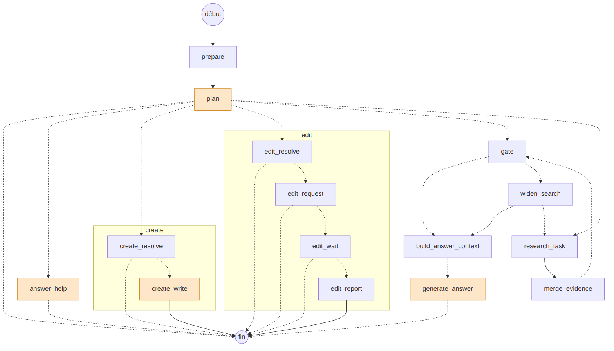
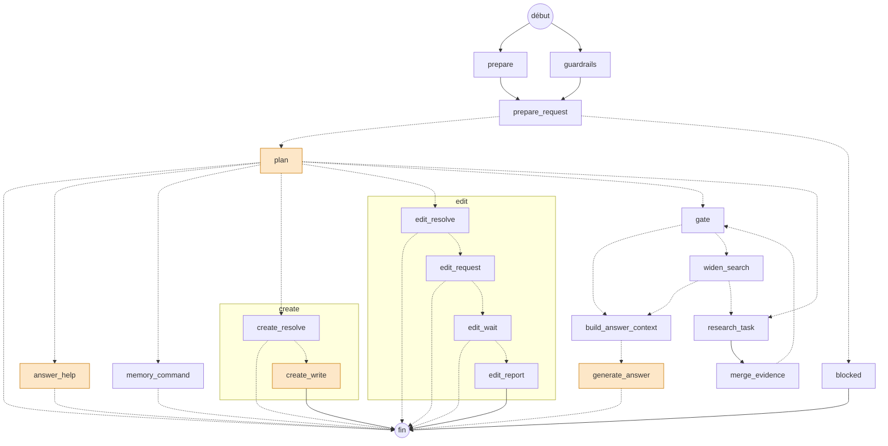

# Le graphe de l'agent d'exécution

Le graphe LangGraph de `worker/agent_execution` (`app/graph/graph.py`), tel que le compile `build_graph()`. Il remplace l'ancien
graphe à quatre ou cinq appels de modèle en série ([audit et proposition](agent-execution-graph-proposal.md)) : **un appel décide
de tout (`plan`), la recherche est du code, un appel écrit la réponse.**

Les nœuds orange appellent un LLM. Les flèches en pointillés sont des arêtes conditionnelles (`app/graph/routing/conditions.py`).
Chaque nœud peut aussi aller à `cancelled` quand l'annulation est demandée : l'arête n'est pas dessinée, pour rester lisible.



Le même dessin en Mermaid, que GitHub affiche directement :



## Détail de chaque nœud

Relevé dans le code. « HTTP » compte les appels au backend (`GET` d'annulation au début du nœud, `PATCH` du statut, un `POST` par
événement). Les arêtes ne refont plus de `GET` d'annulation : le nœud qui a vu la demande positionne `cancelled`.

| Nœud | Vient de → va vers | Ce qu'il fait exactement | Appels LLM | Autre chose utilisée |
|---|---|---|---|---|
| `prepare` | début → `prepare_request` | Charge les collections accessibles (la barrière de permission) et **lit la mémoire de la personne** (`docs/memory.md`, une requête, vide si elle n'est pas utilisée pour ce run). **Ne lit aucun texte** : il part en même temps que `guardrails`. | 0 | Backend : collections, mémoire |
| `guardrails` | début → `prepare_request` | **Garde-fous d'entrée (#516).** Demande au backend ce que les garde-fous décident de la demande (`docs/guardrails.md`) : continuer, continuer masquée, continuer avec un avertissement, ou bloquer. Quand la demande est masquée, `original_query`, `contextualized_query` et le dernier message deviennent le texte masqué. Les événements ne portent que des comptes. Sans garde-fou actif, une seule requête sans appel de modèle. Un contrôle qui ne peut pas être fait fait échouer le run (il n'est pas « passé »). | 0 (1 par garde-fou de type modèle, en parallèle) | Backend : garde-fous ; hub : juges ; services externes |
| `prepare_request` | `prepare` + `guardrails` → `plan` / `blocked` | Attend les deux, puis lit la demande **telle que les garde-fous l'ont laissée** : charge ce que l'utilisateur peut modifier / où il peut créer si elle contient un tel verbe, les outils qu'il peut utiliser, et réduit le catalogue du plan par le pré-filtre vectoriel au-delà de 20 collections (les collections **habituelles** de la personne en tête et un peu favorisées : un a priori, jamais un filtre, `docs/memory.md`). Si la demande est bloquée, il ne fait rien : ni plongement du texte, ni appel d'outils. | 0 | Backend : documents modifiables, collections de création, outils ; Qdrant : pré-filtre |
| `blocked` | `prepare_request` → fin | La demande a été arrêtée : la réponse est le refus des garde-fous (jamais la règle), sans source. Le run est **terminé**, pas en échec. Aucun modèle, aucune recherche, aucun appel au web. | 0 | — |
| `plan` | `prepare` → fin / `answer_help` / `memory_command` / `edit` / `create` / `research_task` | **L'appel n°1.** Lit le message, les 6 derniers tours et le catalogue ; rend un JSON : `mode` (`direct`, `clarify`, `help`, `edit`, `create`, `memory`, `search`) et, pour `search`, la question autonome, 1 à 4 requêtes avec leur outil, les collections et la complexité. `direct` et `clarify` portent la réponse : le run s'arrête là. `memory` n'est proposé que si la mémoire n'est pas suspendue par l'administrateur. Valide tout contre les listes du backend. | **1** | `get_prompt` |
| `memory_command` | `plan` → fin | Ce que la personne demande de sa mémoire dans le chat (« retiens que… », « oublie que… », « que sais-tu de moi ? ») : le backend l'exécute sous les règles de la page « Ma mémoire », et **la réponse est écrite par le code** à partir de ce qui a vraiment été fait. Les événements disent l'action et l'issue, jamais le texte. | 0 | Backend : mémoire |
| `answer_help` | `plan` → fin | Répond à « comment faire dans Muffin » avec le guide intégré. | 1 | `get_prompt` |
| `edit` (sous-graphe) | `plan` → fin | `edit_resolve` valide le document choisi ou explique pourquoi pas ; `edit_request` demande à l'agent d'édition ; `edit_wait` suit le brouillon toutes les 2 s (300 s au plus) ; `edit_report` résume la proposition. N'écrit rien dans la collection. | 0 | Backend, worker `document_edit` |
| `create` (sous-graphe) | `plan` → fin | `create_resolve` valide la collection choisie ; `create_write` écrit le Markdown (jusqu'à 4000 tokens) et le propose. Le document n'existe qu'une fois validé par l'utilisateur. | 1 (`create_write`) | Backend |
| `research_task` | `plan` / `widen_search` → `merge_evidence` | Une branche par requête du plan, jusqu'à 4 en parallèle. Pour `search` : la question déjà répondue (QA), les résumés des documents et les passages sont interrogés **en même temps**, dans les collections choisies et leurs sous-collections. Autres outils : `list_collections`, `collection_summary`, `list_documents`, `page_content`, `tabular_query`, `web_search` (si activée), `time`. | 0 (hors `page_content` : 1, et `tabular_query` : un par tour de la boucle SQL) | Backend (3 recherches parallèles), Qdrant, SearXNG, worker SQL |
| `merge_evidence` | `research_task` → `gate` | Dédoublonne les preuves. | 0 | – |
| `gate` | `merge_evidence` → `build_answer_context` / `widen_search` | Décide **en code** si les preuves suffisent : une recherche de contenu doit donner au moins `GATE_MIN_EVIDENCE` passage(s) au-dessus de `GATE_MIN_SCORE`. Une consultation de la base (liste, comptage, page) suffit toujours. | 0 | – |
| `widen_search` | `gate` → `research_task` | Le plan avait restreint les collections et elles ont donné trop peu : refait les recherches de contenu dans toutes les collections accessibles, une fois. | 0 | – |
| `build_answer_context` | `gate` / `widen_search` → `generate_answer` | Garde les 20 meilleurs extraits, triés par score. | 0 | – |
| `generate_answer` | `build_answer_context` → fin | **L'appel n°2**, en streaming. Réponse avec citations ; les ids inventés sont retirés en code, et une réponse sans citation est gardée telle quelle (le chat l'indique). Sans extrait, répond « rien trouvé » sans appeler le modèle. | **1** | `get_prompt`, flux LLM du backend |
| `ground_check` | après la fin du graphe | **L'appel n°3, optionnel.** Lancé par `AgentService` une fois le run `completed`, pour une réponse difficile seulement (plusieurs requêtes ou complexité forte). Vérifie les affirmations contre les extraits ; le verdict est enregistré sur le run. L'utilisateur ne l'attend pas. | 0 ou 1 | Backend : `PATCH /internal/runs/{id}/grounding` |

## Appels LLM par chemin

| Chemin | Appels |
|---|---|
| Salutation, identité, ou tout ce qui n'a pas besoin des documents | 1 (`plan`) |
| Demande à préciser | 1 (`plan`) |
| Aide sur l'application | 2 (`plan`, `answer_help`) |
| Demande sur la mémoire (« retiens que… ») | 1 (`plan`) |
| Question simple | 2 (`plan`, `generate_answer`) |
| Question complexe | 2, puis 1 après coup (`ground_check`) |
| Modification d'un document | 1 (`plan`) |
| Création d'un document | 2 (`plan`, `create_write`) |
| Demande arrêtée par un garde-fou d'entrée | 0 (`blocked`) |
| Garde-fou d'entrée de type modèle | +1 par garde-fou, en parallèle de `prepare`, avant `plan` |
| Hors graphe, après `completed` | titre de la conversation : +1 |

Hors boucle SQL de `tabular_query`, qui garde son propre budget de tours.

## Régénérer

```bash
cd worker/agent_execution
uv run python scripts/draw_graph.py
```

La liste des nœuds qui appellent un LLM (`LLM_NODES`) est écrite à la main dans le script : elle est à tenir à jour avec `app/graph/nodes`.

> Le script de dessin n'est plus dans le dépôt : le **Mermaid** ci-dessus est à jour des garde-fous d'entrée (#516), pas le PNG.
