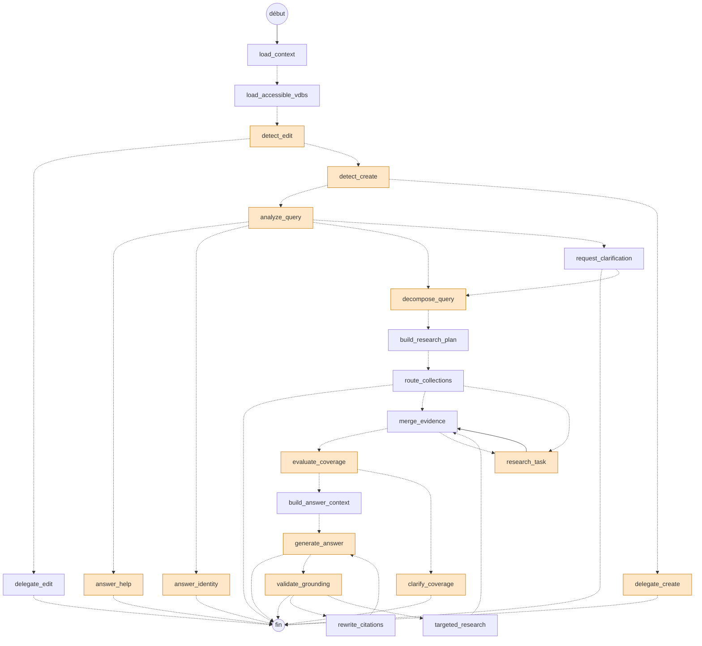

# Le graphe de l'agent d'exécution

Le graphe LangGraph de `worker/agent_execution` (`app/graph/graph.py`), tel que le compile `build_graph()`.
Les nœuds orange appellent un LLM. Les flèches en pointillés sont des arêtes conditionnelles (`app/graph/routing/conditions.py`).
Chaque nœud peut aussi aller à `cancelled` quand l'annulation est demandée : l'arête n'est pas dessinée, pour rester lisible.


Le même dessin en Mermaid, que GitHub affiche directement :



## Lire le dessin

- **Détection d'une édition ou d'une création** (`detect_edit`, `detect_create`) : un filtre par mots-clés passe d'abord, le LLM n'est appelé que si la demande y ressemble.
- **`analyze_query`** : toujours un appel LLM. Selon l'intention, la question part vers l'identité, l'aide, une demande de précision ou la recherche.
- **`decompose_query`** : le LLM n'est appelé que pour une question qui n'est pas simple. Sinon, une tâche de recherche unique est créée sans appel.
- **`route_collections`** : une sonde de recherche (sans LLM) dit si la question tombe clairement dans une collection. Sinon, la run se termine sur une question à l'utilisateur.
- **`research_task`** : une branche par tâche, en parallèle (`MAX_PARALLEL_TASKS`). Chaque branche enchaîne le choix des collections (LLM), la recherche QA, les résumés (LLM de suffisance), puis les chunks.
- **`merge_evidence`** revient sur `research_task` tant que des tâches dépendantes sont prêtes, puis passe à `evaluate_coverage` (LLM).
- **`generate_answer`** écrit la réponse en streaming. `validate_grounding` (LLM) ne passe que pour une réponse de synthèse ou de comparaison, ou multi-sources. Un échec peut relancer une recherche ciblée (`targeted_research`, une fois) ou une réécriture des citations (`rewrite_citations`, une fois).

## Régénérer

```bash
cd worker/agent_execution
uv run python scripts/draw_graph.py
```

La liste des nœuds qui appellent un LLM (`LLM_NODES`) est écrite à la main dans le script : elle est à tenir à jour avec `app/graph/nodes`.
