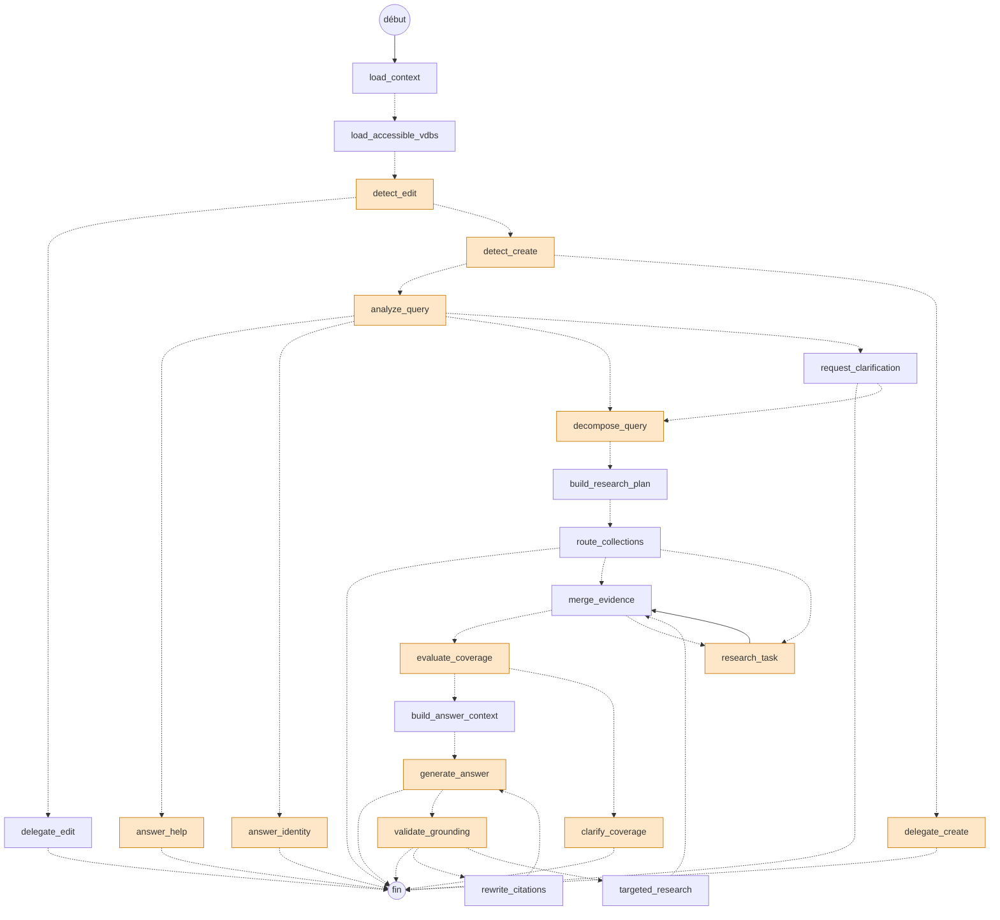

# Le graphe de l'agent d'exécution

Le graphe LangGraph de `worker/agent_execution` (`app/graph/graph.py`), tel que le compile `build_graph()`.
Les nœuds orange appellent un LLM. Les flèches en pointillés sont des arêtes conditionnelles (`app/graph/routing/conditions.py`).
Chaque nœud peut aussi aller à `cancelled` quand l'annulation est demandée : l'arête n'est pas dessinée, pour rester lisible.


Le même dessin en Mermaid, que GitHub affiche directement :



## Lire le dessin

- **Détection d'une édition ou d'une création** (`detect_edit`, `detect_create`) : un filtre par mots-clés passe d'abord, le LLM n'est appelé que si la demande y ressemble.
- **`analyze_query`** : toujours un appel LLM. Selon l'intention, la question part vers l'identité, l'aide, une demande de précision ou la recherche.
- **`decompose_query`** : le LLM n'est appelé que pour une question qui n'est pas simple. Sinon, une tâche de recherche unique est créée sans appel.
- **`route_collections`** : une sonde de recherche (sans LLM) dit si la question tombe clairement dans une collection. Sinon, la run se termine sur une question à l'utilisateur.
- **`research_task`** : une branche par tâche, en parallèle (`MAX_PARALLEL_TASKS`). Chaque branche enchaîne le choix des collections (LLM), la recherche QA, les résumés (LLM de suffisance), puis les chunks.
- **`merge_evidence`** revient sur `research_task` tant que des tâches dépendantes sont prêtes, puis passe à `evaluate_coverage` (LLM).
- **`generate_answer`** écrit la réponse en streaming. `validate_grounding` (LLM) ne passe que pour une réponse de synthèse ou de comparaison, ou multi-sources. Un échec peut relancer une recherche ciblée (`targeted_research`, une fois) ou une réécriture des citations (`rewrite_citations`, une fois).

## Détail de chaque nœud

Relevé dans le code (`app/graph/nodes`, `app/graph/routing/conditions.py`), **pas mesuré**. « HTTP » compte les appels au
backend : `GET /runs/{id}` pour l'annulation (`is_cancelled`), `PATCH` du statut (`set_activity`) et `emit` (un `POST`
d'événement chacun). Les arêtes conditionnelles `after_*` refont un `GET` d'annulation ; `route_or_cancel` n'en fait pas.
`get_prompt` ajoute un `GET` quand le prompt n'est pas en cache (60 s) ou qu'aucune version active n'existe.

| Nœud | Vient de → va vers | Ce qu'il fait exactement | Appels LLM | Autre chose utilisée | HTTP ≈ |
|---|---|---|---|---|---|
| `load_context` | début → `load_accessible_vdbs` | Marque la run comme démarrée. | 0 | – | 2 |
| `load_accessible_vdbs` | `load_context` → `detect_edit` | Charge les collections accessibles à l'utilisateur (barrière de sécurité : rien ne dépasse cette liste). | 0 | Backend : liste des collections | 5 |
| `detect_edit` | `load_accessible_vdbs` → `delegate_edit` / `detect_create` | Un filtre par mots-clés (`_EDIT_VERBS`) décide si le message ressemble à une modification de document. Si oui, le LLM choisit le document parmi ceux que l'utilisateur peut modifier. | 0, ou 1 si un mot-clé correspond | Backend : liste des documents modifiables (si mot-clé) | 2 (≈6 si mot-clé) |
| `detect_create` | `detect_edit` → `delegate_create` / `analyze_query` | Idem avec `_CREATE_VERBS` : le LLM dit si c'est une création de document Markdown, et dans quelle collection. | 0, ou 1 si un mot-clé correspond | Backend : liste des collections modifiables (si mot-clé) | 2 (≈6 si mot-clé) |
| `delegate_edit` | `detect_edit` → fin | Demande au backend de lancer l'agent d'édition, puis attend son verdict (sondage toutes les 2 s, 300 s au plus). N'édite rien lui-même. | 0 | Backend : création de la demande ; worker `document_edit` ; sondage | ≈4 + 2 par sondage |
| `delegate_create` | `detect_create` → fin | Écrit le document Markdown (jusqu'à 4000 tokens) et le propose à valider. | 1 | Backend : création du brouillon | ≈7 |
| `analyze_query` | `detect_create` → `answer_help` / `answer_identity` / `request_clarification` / `decompose_query` | Comprend la demande avec tout l'historique : intention, complexité, ambiguïté, question autonome (`standalone_query`). | **1, toujours** | `get_prompt` | 5-6 |
| `answer_identity` | `analyze_query` → fin | Répond « qui es-tu » avec la liste des capacités. | 1 | `get_prompt` | 4-5 |
| `answer_help` | `analyze_query` → fin | Répond « comment faire dans Muffin » à partir d'un guide intégré. | 1 | `get_prompt` | 4-5 |
| `request_clarification` | `analyze_query` → `decompose_query` / fin | Termine la run sur les questions du modèle (déjà produites par `analyze_query`). Sans question possible (run programmatique, déjà 2 tours), continue en posant des hypothèses. | 0 | – | 3 |
| `decompose_query` | `analyze_query` ou `request_clarification` → `build_research_plan` | Découpe en tâches de recherche (un graphe de dépendances). Question simple et pas « meta » : une seule tâche `search`, sans appel. | 0 si simple, sinon 1 | `get_prompt` | 4-5 |
| `build_research_plan` | `decompose_query` → `route_collections` | Sépare les tâches prêtes de celles qui attendent une dépendance. Écrit le plan dans la run. | 0 | Backend : écriture du plan | 4 |
| `route_collections` | `build_research_plan` → `research_task` (une branche par tâche prête) / `merge_evidence` / fin | Sonde de confiance : une recherche sur toutes les collections dit si la question tombe clairement dans l'une d'elles. Sinon, la run se termine sur une question à l'utilisateur. Sauté avec moins de 2 collections, collections épinglées, ou aucune tâche `search`. | 0 | Backend : pré-filtre vectoriel (si beaucoup de collections) et sonde de recherche (embedding + Qdrant) | 2 si sauté, ≈6 sinon (2 `GET` d'annulation) |
| `research_task` | `route_collections` ou `merge_evidence` → `merge_evidence` | Une tâche, jusqu'à 4 en parallèle. Selon son outil, voir le tableau suivant. | voir ci-dessous | voir ci-dessous | ≈6 + recherches |
| `merge_evidence` | `research_task` ou `targeted_research` → `research_task` (tâches débloquées) / `evaluate_coverage` | Dédoublonne les preuves. Relance `research_task` tant que des tâches dépendantes sont prêtes. | 0 | – | 4 |
| `evaluate_coverage` | `merge_evidence` → `build_answer_context` / `clarify_coverage` | Les preuves suffisent-elles ? Sans appel pour une recherche « meta » (liste, comptage), ni quand aucune preuve n'a été trouvée (insuffisant d'office). | 0 ou 1 | `get_prompt` | 5 |
| `clarify_coverage` | `evaluate_coverage` → fin | Preuves insuffisantes : termine la run sur des questions proposant des interprétations. | 1 | `get_prompt` | 4 |
| `build_answer_context` | `evaluate_coverage` → `generate_answer` | Garde les 20 meilleurs extraits, triés par score. Aucun calcul lourd. | 0 | – | 3 |
| `generate_answer` | `build_answer_context` ou `rewrite_citations` → fin / `validate_grounding` | Écrit la réponse avec citations, en streaming (texte partiel publié toutes les x secondes). Si aucune citation, redemande une fois. Terminal si simple ou « meta ». | **1** (2 si aucune citation) | `get_prompt` ; backend : flux LLM + mises à jour du texte partiel | ≈7 + mises à jour |
| `validate_grounding` | `generate_answer` → fin / `targeted_research` / `rewrite_citations` | Vérifie chaque affirmation contre les extraits : non soutenues, mal citées, sans citation. | 1 | `get_prompt` | 5 |
| `targeted_research` | `validate_grounding` → `merge_evidence` | Recherche ciblée sur les affirmations non soutenues (3 au plus, une fois par run). | 1 par affirmation (jusqu'à 3) | Backend : recherche par affirmation | ≈4 + 2 par affirmation |
| `rewrite_citations` | `validate_grounding` → `generate_answer` | Prépare la réécriture de la réponse avec ses citations corrigées (une fois). Aucun calcul. | 0 (mais déclenche un nouvel appel de `generate_answer`, puis la fin sans re-validation) | – | 3 |

### Ce que fait `research_task`, outil par outil

Chaque tâche commence par `select_relevant_vdbs` (choix des collections), sauf `list_collections`, `web_search` et `time`. Ce choix coûte **0 appel s'il y a une seule collection accessible, sinon 1 appel LLM**, avec un pré-filtre vectoriel (backend) quand il y en a beaucoup. Il refait ce que la sonde de `route_collections` sait déjà.

| Outil | Ce qu'il fait | Appels LLM | Autre chose utilisée |
|---|---|---|---|
| `search` (défaut) | Cascade en trois étages, en série. 1) QA : une question déjà répondue (score ≥ seuil) arrête tout. 2) Résumés : les 5 meilleurs résumés suffisent-ils ? 3) Chunks : recherche hybride. | choix des collections (0-1) + suffisance des résumés (0-1, seulement si des résumés existent) | Backend : `search_qa`, `search_summaries`, `search` (chacune embedde la requête de son côté, donc jusqu'à 3 embeddings) |
| `list_collections` | Liste les collections accessibles et leur nombre. | 0 | Aucun appel |
| `collection_summary` | Décrit les collections choisies. | 0-1 (choix) | – |
| `list_documents` | Liste les documents des collections choisies avec leur résumé. | 0-1 (choix) | Backend : un `GET` par collection |
| `page_content` | Lit une page d'un document. | 0-1 (choix) + 1 (quel document et quelle page) | Backend : liste des documents, lecture de la page |
| `tabular_query` | Interroge des fichiers CSV/XLSX en SQL, avec correction des requêtes en cas d'erreur. | 0-1 (choix) + 1 par tour de la boucle (jusqu'à 2×8 + 6 = 22) | Backend : catalogue ; worker SQL `tabular` (file `tabular_sql`, sondage toutes les 0,3 s) ; graphiques |
| `web_search` | Recherche web, seulement si l'utilisateur l'a activée. | 0 | SearXNG |
| `time` | Date et heure précises, périodes relatives. Calcul pur. | 0 | Aucun appel |

### Nombre d'appels LLM par chemin

| Chemin | Appels, dans l'ordre | Total |
|---|---|---|
| Identité ou aide | `analyze_query`, puis la réponse | 2 |
| Question simple, 1 collection | `analyze_query`, suffisance des résumés (si résumés), `evaluate_coverage`, `generate_answer` | 3 à 4 |
| Question simple, plusieurs collections | idem, plus le choix des collections | 4 à 5 |
| Question complexe, N tâches | `analyze_query`, `decompose_query`, N × (choix + suffisance), `evaluate_coverage`, `generate_answer`, `validate_grounding` | 5 + 2N |
| Idem avec grounding en échec | plus jusqu'à 3 choix, `generate_answer` de nouveau, éventuellement `validate_grounding` de nouveau | + 5 environ |
| Preuves insuffisantes | `analyze_query`, …, `evaluate_coverage`, `clarify_coverage` | 3 à 6 |
| Hors graphe | titre de la conversation, après `completed` : 1 appel, qui n'attend pas l'utilisateur mais occupe le worker | +1 |

### Ce qui coûte hors LLM

- Chaque nœud fait de 2 à 6 appels HTTP au backend pour l'annulation, le statut et les événements. Une run simple en cumule plusieurs dizaines, tous en synchrone.
- `RedisSaver` écrit l'état complet (preuves comprises) après chaque nœud.
- `get_prompt` n'est mis en cache que si une version active existe. Sans version active, chaque appel refait un `GET` (c'est le cas dans les tests : « No active prompt version »).

## Régénérer

```bash
cd worker/agent_execution
uv run python scripts/draw_graph.py
```

La liste des nœuds qui appellent un LLM (`LLM_NODES`) est écrite à la main dans le script : elle est à tenir à jour avec `app/graph/nodes`.
