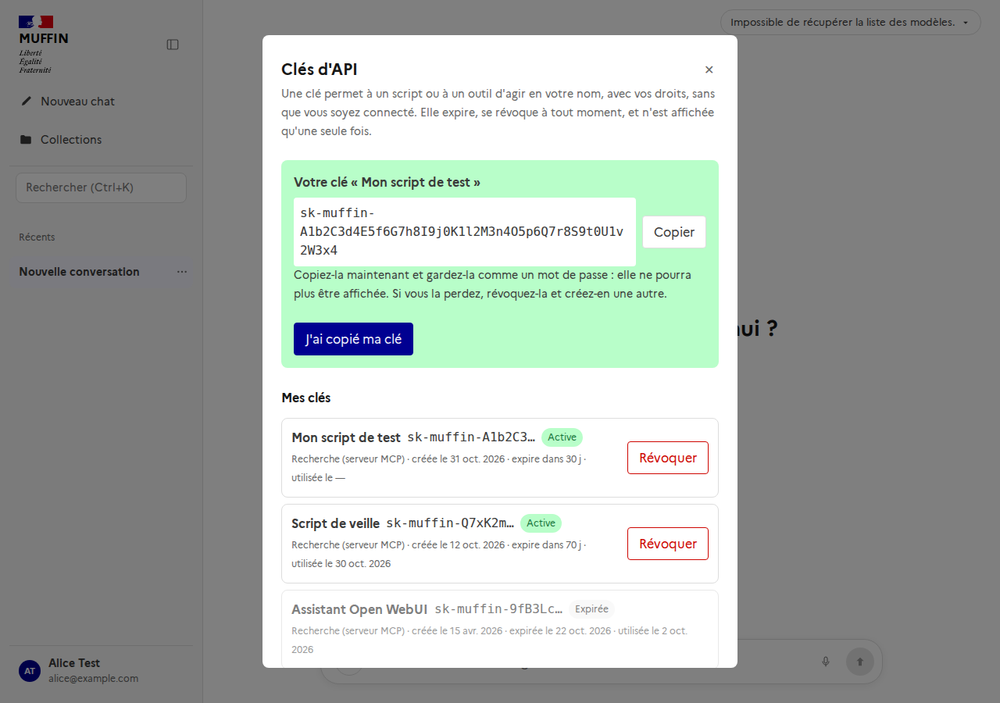

# Clés d'API personnelles (#521, #513)

Une clé d'API permet à un script ou à un outil (un client MCP, Open WebUI, un autre agent) d'agir au nom de son propriétaire, **sans
session ouverte** et sans jeton Keycloak qui expire en quelques minutes. Chaque utilisateur gère les siennes : menu utilisateur →
**Clés d'API**.



Une clé sert à appeler le **serveur MCP** (`/api/mcp/`, portée `search`) ou l'**API compatible OpenAI** (`/v1`, portée `chat`,
voir `openai-api.md`).

## Ce que c'est

`sk-muffin-` + 43 caractères aléatoires (256 bits) + un checksum de 6 caractères :

```
sk-muffin-Q7xK2mP0...aB9d3F        (59 caractères)
```

- Le **préfixe** distingue la clé de toute autre chaîne ; le **checksum** (CRC32 des 43 caractères) sert aux outils de détection de
  secrets (qui reconnaissent le format sans faux positifs) et à écarter sans requête une clé mal recopiée. Il ne protège rien : ce qui
  protège une clé, c'est qu'elle est aléatoire et longue.
- Elle est **affichée une seule fois**, à la création (réponse de `POST /api/api-keys`, `Cache-Control: no-store`). Perdue, elle se
  révoque et se remplace.

## Comment elle est gardée

| | |
|---|---|
| Base de données | `HMAC-SHA256(poivre, clé)` précédé de la version du poivre (`v1$…`). **Jamais la clé**. Les 16 premiers caractères (`sk-muffin-` et 6) sont gardés pour la reconnaître dans les listes. |
| Pourquoi pas bcrypt ou argon2 | Ils sont faits pour des mots de passe humains, qu'on devine par dictionnaire. Une clé de 256 bits n'a rien à deviner : un hachage lent ne ferait qu'ajouter de la latence à chaque requête. |
| Le poivre | `API_KEY_PEPPERS`, un secret du déploiement. Une copie de la base **sans** le poivre ne permet ni de forger ni de vérifier une clé. |
| Journaux | Seuls l'identifiant, le préfixe visible, le propriétaire et les portées sont journalisés, jamais la clé. |

La cible est de ranger le poivre dans Vault (#521) ; en attendant, un secret Kubernetes.

## Ce qu'elle permet, et ce qu'elle ne permet pas

- Elle représente **son propriétaire**, avec ses droits : ses collections, celles partagées avec lui, ses groupes. Ses groupes **dans
  Muffin** sont relus à chaque appel ; ses groupes **Keycloak** sont ceux qu'il avait à sa dernière connexion (une clé n'a pas de jeton
  d'où les lire) : ils sont remis à jour à chaque connexion.
- Elle n'est **jamais administrateur**, même si son propriétaire l'est.
- Elle ne gère pas les clés : créer, lister et révoquer exigent une session ou un jeton Keycloak.
- Elle est limitée à la **portée** donnée à sa création, et expire toujours (90 jours par défaut, 365 au plus).

## Cycle de vie

- **Création** : `POST /api/api-keys` `{name, scopes, expires_in_days}` → 201 avec la clé. 503 si aucun poivre n'est réglé, 409 au-delà de
  `API_KEYS_PER_USER` clés valides, 422 pour une portée inconnue ou une durée trop longue.
- **Liste** : `GET /api/api-keys` (les siennes, jamais le secret) : nom, préfixe, portées, créée, expire, dernière utilisation,
  révoquée.
- **Révocation** : `DELETE /api/api-keys/{id}`, **immédiate** (la clé reste listée comme révoquée).
- **Dernière utilisation** : notée au plus une fois par minute et par clé, pour qu'une clé très utilisée n'écrive pas à chaque requête.
- **Limitation** : `API_KEY_RATE_LIMIT_PER_MINUTE` requêtes par minute et par clé (Redis) ; au-delà `429` avec `Retry-After: 60`.
- Une clé inconnue, révoquée, expirée ou d'une autre portée reçoit la **même** réponse `401` : on ne dit pas pourquoi.

## Rotation du poivre

`API_KEY_PEPPERS="v2=nouveau,v1=ancien"` : les nouvelles clés sont hachées avec `v2`, celles faites avec `v1` continuent de marcher. Une fois
les clés `v1` expirées ou remplacées (`SELECT count(*) FROM api_keys WHERE key_hash LIKE 'v1$%' AND revoked_at IS NULL AND expires_at >
now()`), on retire `v1`. Retirer un poivre trop tôt invalide les clés qui en dépendent ; **perdre tous les poivres invalide toutes les
clés**.

## Si une clé fuit

1. Sa révocation (`DELETE /api/api-keys/{id}` ou le bouton **Révoquer**) la coupe immédiatement.
2. Les journaux du serveur montrent quel identifiant et quel préfixe l'ont créée ; la liste montre sa dernière utilisation.
3. Si c'est le **poivre** qui a fui avec une copie de la base : le remplacer ne suffit pas (il vérifie encore) ; il faut révoquer les
   clés et les refaire.

## Dans un client MCP

```
Authorization: Bearer sk-muffin-…
```

sur `https://<muffin>/api/mcp/`. L'outil d'Open WebUI (`docs/owui-muffin-tool.md`) envoie sa valve `FALLBACK_TOKEN` telle quelle en `Bearer` : une clé y
fonctionnerait donc, avec la même réserve que pour un jeton (tous les utilisateurs sans session Keycloak auraient l'identité de
son propriétaire). **Non essayé avec Open WebUI.**

## Limites

- Pas encore d'interface d'administration pour voir ou révoquer les clés des autres : un administrateur n'a pas ce droit.
- Pas d'enregistrement du préfixe auprès des programmes d'analyse de secrets (GitHub, GitLab) : à étudier.
- Le poivre est un secret Kubernetes en attendant Vault.
