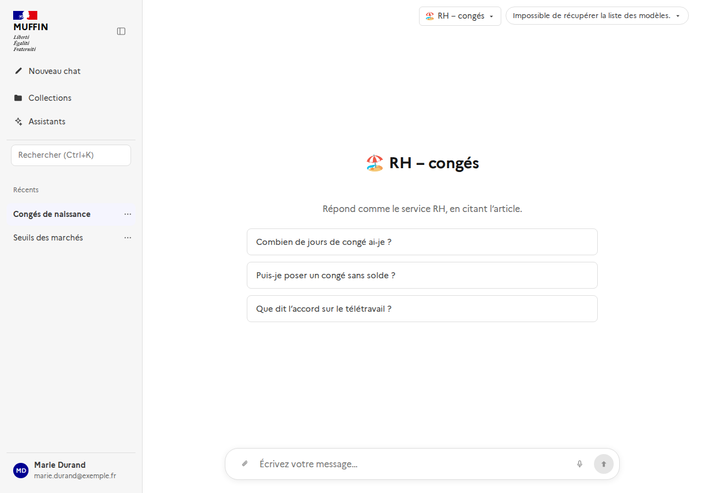
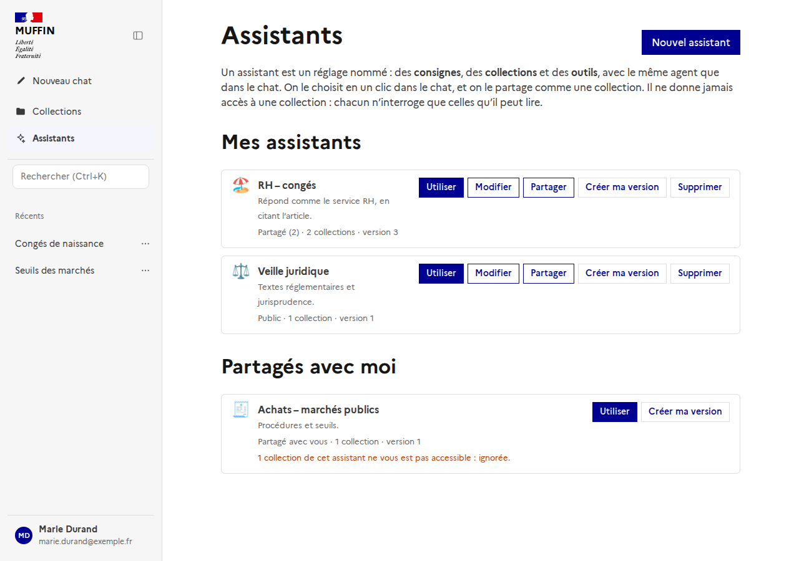
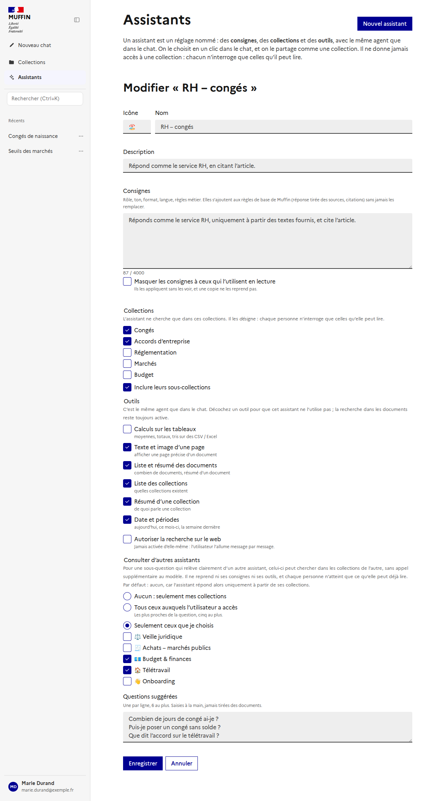
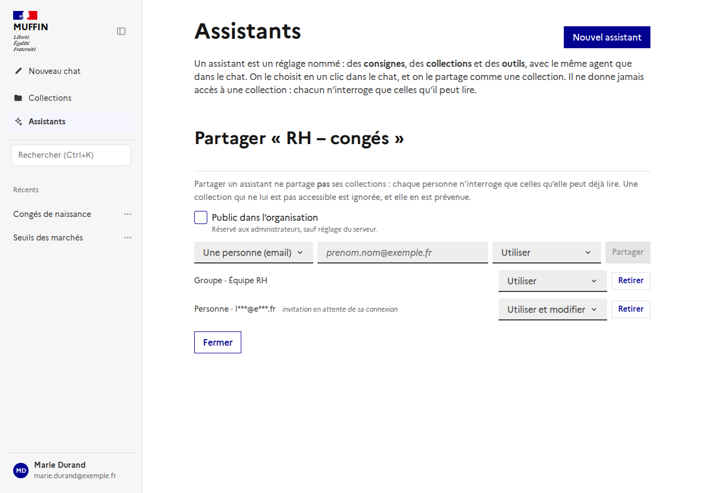
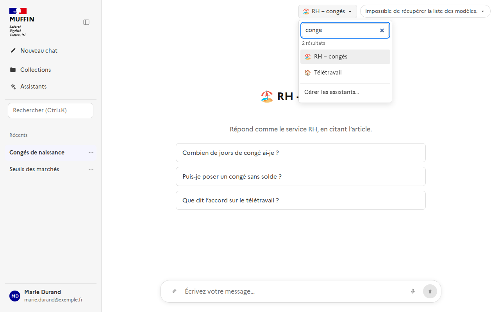

# Les assistants (#514)

Un **assistant** est un réglage nommé que l'on choisit en un clic dans le chat, et que l'on partage comme une collection. Il tourne sur
**le même agent** (le même graphe LangGraph) que le chat sans assistant : il n'en change que trois choses.

| | Ce que l'assistant fixe |
|---|---|
| **Consignes** | Du texte (4 000 caractères au plus) ajouté à la fin des règles de la rédaction : rôle, ton, format, langue, règles métier. |
| **Collections** | Celles où l'agent cherche, avec ou sans leurs sous-collections. Sans collection, il cherche partout où la personne peut lire. |
| **Outils** | Les outils facultatifs de l'agent qu'il n'utilise pas, et si la recherche sur le web peut être allumée. |

S'y ajoutent un nom, une description, une icône, des **questions suggérées** (saisies à la main, jamais tirées des documents) et une
visibilité. *Barre latérale → Assistants* pour les créer ; le sélecteur à côté du modèle, dans le chat, pour en choisir un.

## Ce qu'un assistant ne fait pas

**Il ne donne jamais accès à une collection : il la désigne.** À chaque message, les collections cherchées sont celles que
l'assistant désigne **et** que la personne qui l'utilise peut lire (ses droits, ses groupes), par le même code que le chat. Ce calcul
est fait en code (`AssistantService.resolve`), jamais par un modèle.

- Une collection désignée que la personne ne peut pas lire est **ignorée**. Elle n'est **ni nommée ni décrite** : l'interface dit
  seulement « 1 collection de cet assistant ne vous est pas accessible ». Aucun extrait n'en sort.
- Si **aucune** des collections désignées n'est lisible, la réponse est `409` : chercher « partout » à la place répondrait à partir de
  sources que l'assistant n'avait pas prévues.
- Partager un assistant n'est pas partager ses collections. Pour qu'un destinataire en voie le contenu, la collection doit lui être
  partagée à part.
- Une collection supprimée après coup : l'assistant continue avec les autres, et le dit de la même façon.
- L'agent reste **dans** les collections de l'assistant : le planificateur peut en restreindre le champ, jamais l'élargir
  (`Run.scope_locked`, `prepare`). Il n'y a pas d'élargissement vers « les autres collections de la personne ».
- Les consignes ne **remplacent** aucune règle : elles viennent après le prompt, la règle de citation et le format de réponse, et
  disent qu'elles ne les changent pas (`assistant_rules`). Elles ne peuvent pas non plus étendre les droits, qui se règlent hors du
  modèle.
- La recherche sur le web n'est jamais allumée par l'assistant : il dit seulement si le message peut la demander.

## Les outils

C'est le même graphe ; un assistant retire des outils au **planificateur** (`plan`). Ceux qu'il peut couper : calculs sur les tableaux
(`tabular_query`), texte d'une page (`page_content`), liste et résumé des documents (`list_documents`), liste des collections
(`list_collections`), résumé d'une collection (`collection_summary`), date et périodes (`time`). La recherche dans les documents
(`search`) ne se coupe pas : une réponse en est faite.

Le guide des outils donné au modèle ne mentionne plus l'outil coupé, **et** ce que le modèle choisit est vérifié contre la même liste
(`plan._queries`) : un outil coupé que le modèle choisirait quand même retombe sur `search`. Les outils MCP et les outils
administrables (#343) ne sont pas encore rattachés aux assistants.

## Qui voit quoi

| | Auteur | Écriture | Lecture | Public |
|---|---|---|---|---|
| Utiliser | oui | oui | oui | oui |
| Voir les consignes | oui | oui | sauf si l'auteur les masque | idem |
| Modifier | oui | oui | non | administrateur |
| Partager, publier, supprimer | oui | non | non | administrateur : retirer |

- **Masquer les consignes** : ceux qui lisent l'assistant les appliquent sans les voir (`instructions` est `null` et
  `instructions_hidden` vrai dans la réponse). Une copie (« Créer ma version ») ne reprend alors **pas** les consignes, ni les
  collections que le copiste ne peut pas lire.
- **Écriture** : on modifie l'assistant. Qui enregistre ne perd pas les collections qu'on ne lui montrait pas : elles sont gardées.
- **Public dans l'organisation** : réservé aux administrateurs, sauf `ASSISTANTS_PUBLIC_ENABLED`. Un administrateur peut toujours
  retirer ou supprimer un assistant public, et rien d'autre.
- Un assistant privé n'est visible de personne d'autre : toute lecture, modification, copie, partage ou utilisation répond `404`.

## Partage

Le même mécanisme que les collections (`docs/collection-sharing.md`) : par email ou groupe Keycloak (invitation hachée, **résolue à la
connexion** de la personne, sans jamais dire si l'adresse a un compte), ou par un groupe fait dans Muffin (actif tout de suite). Droit
`read` (utiliser) ou `write` (utiliser et modifier). Retirer un partage retire l'assistant de la liste du destinataire tout de suite ;
un message en cours de rédaction n'est pas touché.

## Versions et traçabilité

Chaque modification (consignes, collections, outils, visibilité…) fait passer l'assistant à la **version** suivante ; une modification
qui ne change rien n'en crée pas. Un run garde l'identifiant, le nom, la **version** et les **consignes** de l'assistant tels qu'ils
étaient (`runs.assistant_*`, sans clé étrangère : ils survivent à une suppression). Chaque réponse du chat affiche l'assistant qui l'a
écrite. Pas de retour arrière pour l'instant, mais le schéma le permet.

La création, la modification (les champs changés, jamais le texte des consignes), le partage, la publication et la suppression sont
journalisés : qui, quand, quoi.

## API

`/api/assistants` : liste (les miens, ceux partagés avec moi, les publics), `POST`, `GET`, `PATCH`, `DELETE /{id}`,
`POST /{id}/duplicate`, `PUT /{id}/visibility`, et `/{id}/shares` (`POST`, `GET`, `PATCH`, `DELETE`). Dans `POST /api/runs`,
`assistant_id` remplace `collection_ids` ; la réponse porte `assistant_id`, `assistant_name`, `assistant_version` et
`assistant_inaccessible_collections`. `AssistantService.resolve(user, assistant_id)` ne dépend d'aucune route : l'API compatible OpenAI
(`docs/openai-api.md`) et le MCP pourront l'utiliser.

## Retrouver un assistant (#531)

*Rechercher un assistant* (sélecteur du chat, page Assistants) cherche par ce que l'assistant dit faire, **parmi tous ceux que la personne
peut lire** (les siens, ceux partagés avec elle, les publics) : `GET /api/assistants/search?q=`. `GET /api/assistants/suggest?q=` propose
ceux dont la description colle à une question, éventuellement aucun ; **une suggestion n'applique jamais un assistant**.

La recherche fait le moins d'appels possible (`docs/search.md`) : avec moins de 8 assistants, elle se fait sur les mots, **dans le
navigateur, sans aucune requête** ; au-delà, une seule requête après une pause de frappe (la précédente est annulée), une recherche
hybride sur les descriptions, **un seul appel d'embedding pour la question** (gardé quelques minutes), et jamais de modèle de langage. Ce
qui est cherché : le nom, la description et les questions suggérées - **jamais** les consignes ni les noms des collections, pour qu'on ne
puisse rien en deviner.

## Consulter d'autres assistants (#531)

Un assistant peut **chercher dans les collections d'autres assistants** pour une sous-question qui relève clairement de l'un d'eux. C'est
le même graphe de l'agent : le planificateur, dans son appel habituel, ajoute `"assistant": id` à une de ses requêtes, et celle-ci est
cherchée dans les collections de cet assistant au lieu de celles de l'assistant principal. **Aucun appel de plus au modèle.**

- **Réglage** (formulaire, « Consulter d'autres assistants ») : *aucun* (par défaut : l'assistant répond uniquement à partir de ses
  collections), *tous ceux auxquels l'utilisateur a accès*, ou *seulement ceux que je choisis*.
- **Qui est consultable, calculé en code à la création du message** (`AssistantService._consultable`) : parmi les assistants que **la
  personne qui discute** peut lire, jamais l'assistant lui-même, seulement ceux qui ont des collections, et **seulement par celles de leurs
  collections que cette personne peut lire**. Le résultat est figé sur le run (`runs.consultable_assistants`) : le modèle ne choisit
  que là-dedans, et la portée verrouillée de l'assistant (`scope_locked`) s'élargit de ces collections-là et d'aucune autre.
- **Peu d'appels** : jusqu'à `ASSISTANTS_CONSULT_MAX` (5) candidats, tous sont proposés, sans aucune recherche ; au-delà, les plus proches
  de la question par la recherche hybride (un embedding, partagé avec le routage des collections).
- **Ce qui est repris de l'assistant consulté** : ses collections et ses outils coupés pour cette sous-question. **Pas ses consignes** :
  elles servent à écrire une réponse, et l'assistant principal écrit la seule réponse. Il ne consulte pas à son tour (un seul niveau), et
  seule une recherche de contenu lui est confiée.
- Chaque source citée dit l'assistant consulté qui l'a trouvée (`consulted_assistant`).
- Une liste d'assistants à consulter n'est jamais montrée au-delà de ce que la personne peut lire : les autres sont seulement comptés, et
  qui enregistre ne les perd pas.

## Réglages et limites

- `ASSISTANTS_PUBLIC_ENABLED`, `ASSISTANTS_PER_USER`, `ASSISTANTS_SEARCH_INDEX_MIN`, `ASSISTANTS_SEARCH_LIMIT`, `ASSISTANTS_SUGGEST_MIN_SCORE` et
  `ASSISTANTS_CONSULT_MAX` : voir `docs/environment-variables.md`. Le modèle d'embedding est celui de l'administration.
- Pas encore : les assistants comme `model` de `GET /v1/models`, un avertissement au moment du partage qui compare les destinataires aux
  droits sur les collections (une invitation n'a pas d'identité tant que la personne ne s'est pas connectée), le choix du modèle de
  langage par assistant, la mémoire propre à un assistant.
