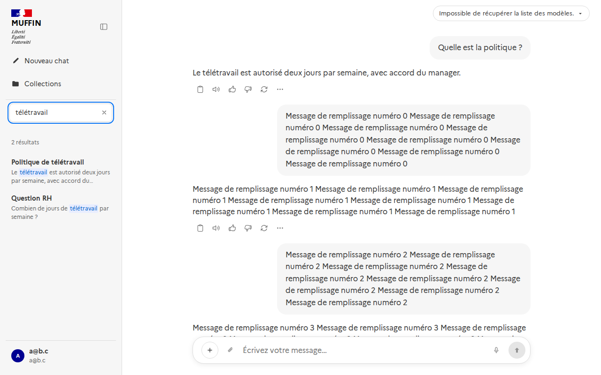
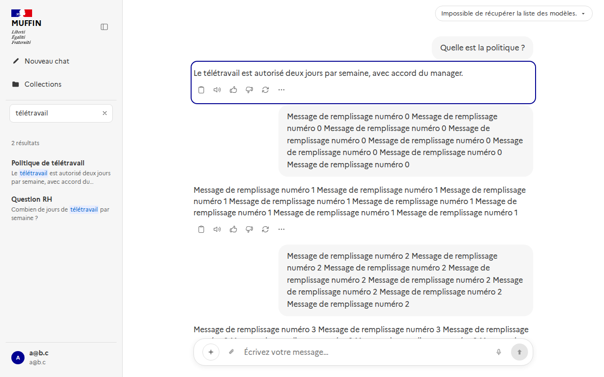

# Recherche dans les conversations (#509)

Un champ de recherche en haut de la barre latérale du chat retrouve les conversations de l'utilisateur dont le **titre** ou le
**contenu des messages** correspond. Il n'accède jamais qu'à **ses propres** conversations.



Un clic ouvre la conversation **sur le message trouvé**, qui est entouré un instant.



## Utilisation

- `Ctrl+K` (ou `⌘K`) place le curseur dans le champ, même quand la barre latérale est réduite. `Échap` ou la croix efface la
  recherche et ramène l'historique.
- Deux caractères au moins ; la recherche part 250 ms après la dernière frappe.
- La casse et les **accents** sont ignorés (« conges » trouve « congés ») et les mots sont pris à la racine (« procédure »
  trouve « procédures »).
- Syntaxe des moteurs de recherche : `"plan de continuité"` pour une expression exacte, `-formation` pour exclure un mot,
  `budget or plan` pour l'un ou l'autre.
- Une conversation n'apparaît qu'une fois, avec le passage de son meilleur message. Une conversation dont le titre correspond
  passe avant celles dont seuls les messages correspondent. La liste s'allonge en défilant.

## API

`GET /api/conversations/search?q=…&page=1&page_size=20`, réservée aux conversations de l'appelant.

```json
{ "items": [ { "id": "…", "title": "Politique de télétravail", "updated_at": "…", "title_matched": true,
               "message_id": "…", "snippet": "Le \u0002télétravail\u0003 est autorisé…" } ],
  "total": 1, "page": 1, "page_size": 20 }
```

`message_id` et `snippet` sont `null` quand seul le titre correspond. Les mots trouvés sont encadrés par les caractères de
contrôle U+0002 et U+0003, **pas par du HTML** : le texte d'un message n'est jamais interprété, le front le découpe et l'affiche
comme du texte.

## Fonctionnement

- Une configuration de recherche `muffin_french` (copie de `french` dont les mots passent d'abord par `unaccent`) et une colonne
  `messages.content_tsv`, **générée** par la base à partir du contenu et indexée (GIN). Une recherche lit ces mots déjà
  préparés au lieu d'analyser de nouveau chaque message de l'utilisateur.
- Mesure sur 200 000 messages dont 10 000 à l'utilisateur, **tous** correspondant au mot cherché (le pire cas) : 90 à 180 ms.
  Pour un mot qui n'existe pas : 4 ms ; pour un mot présent dans une fraction des messages : quelques dizaines de ms.
- Le classement utilise `ts_rank`. `ts_rank_cd` donne un classement plus fin mais coûtait 15 fois plus (940 ms contre 58 ms).
- Le passage affiché est calculé seulement pour les résultats de la page demandée.

## Limites

- L'extension PostgreSQL `unaccent` doit pouvoir être créée par la migration. Elle est « de confiance » depuis PostgreSQL 13 :
  le propriétaire de la base suffit.
- La colonne générée ajoute à chaque message ses mots préparés, et l'index GIN : de l'espace disque en plus, à surveiller sur une très grosse base.
- Pas de recherche sémantique : seul le vocabulaire cherché est trouvé, pas ses synonymes.
