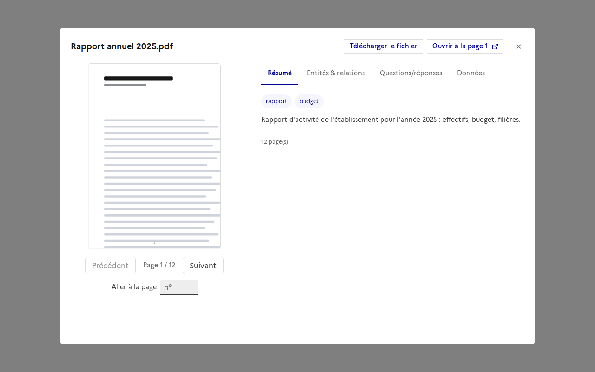
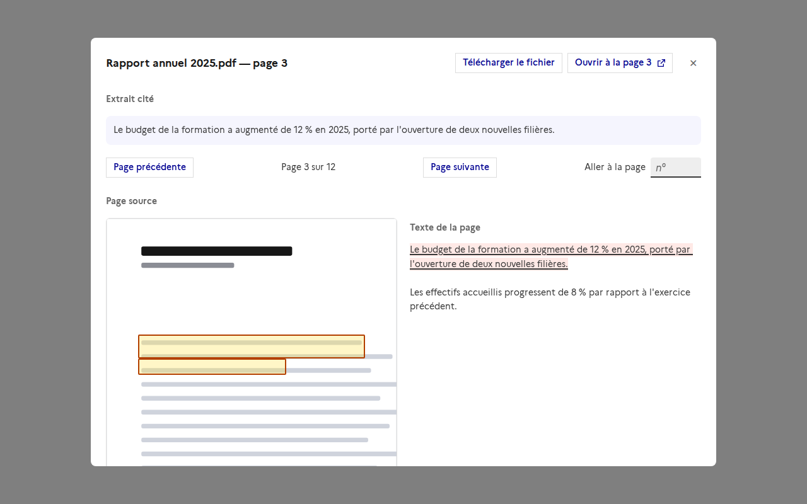
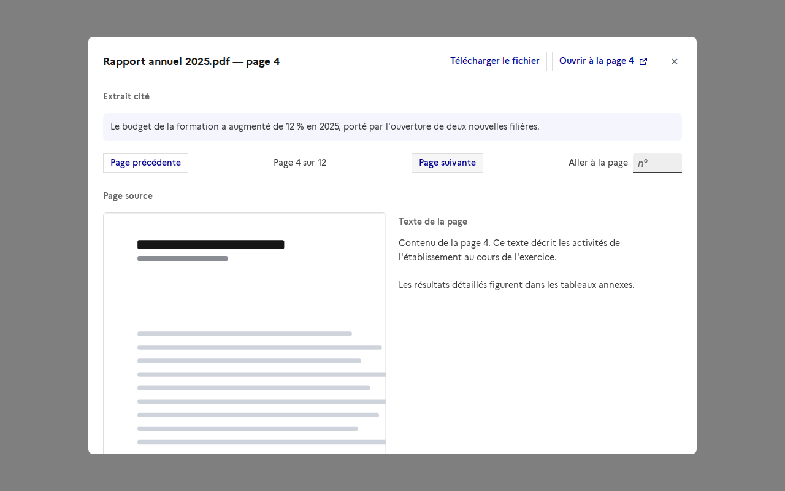

# Le fichier d'un document : télécharger, ouvrir à la page, parcourir les pages

Un document déposé dans une collection garde son **fichier d'origine** dans le stockage. Trois façons d'y revenir, depuis la fiche
d'un document et depuis la visionneuse d'une source citée.

## Télécharger

`GET /api/collections/{collection}/documents/{document}/file` renvoie le fichier en pièce jointe, sous son nom d'origine (accents et
espaces compris). Il passe par le backend, jamais par un lien de stockage : chaque accès est revérifié contre les droits de lecture de
l'utilisateur sur la collection, comme les captures de pages. Le fichier est envoyé par morceaux, sans être lu en entier en mémoire.

Un document fait d'une adresse web n'a pas de fichier (404) ; l'interface n'affiche alors pas le bouton.

## Ouvrir à la page

Avec `?inline=true`, le navigateur affiche le fichier dans son propre onglet, et un PDF s'ouvre sur une page avec `#page=N`
(« Ouvrir à la page N »). **Seuls les PDF et les images (png, jpeg, gif, webp) peuvent s'afficher ainsi** : tout autre type (HTML, SVG,
Word, Excel…) est toujours téléchargé, même si `inline` est demandé. Un fichier déposé par un utilisateur ne doit pas s'exécuter dans
l'origine de l'application. L'en-tête `X-Content-Type-Options: nosniff` est ajouté.

## Parcourir les pages

La fiche d'un document, avec « Télécharger le fichier », « Ouvrir à la page N » et « Aller à la page » :

La visionneuse d'une source citée sur la page citée : le passage surligné dans le texte, les zones encadrées sur la page, et de quoi
parcourir tout le document ou télécharger le fichier :

Une page non citée, atteinte avec « Page suivante » (sans surlignage ni cadre) :

(Captures faites avec une API simulée : le contenu est un exemple.)

- **La fiche d'un document** montre déjà une capture par page, avec « Précédent / Suivant ». S'y ajoutent « Aller à la page » et les deux
  boutons ci-dessus.
- **La visionneuse d'une source citée** (clic sur une source dans le chat, une question-réponse, une entité) ne montrait que les pages
  citées. Elle permet maintenant de **parcourir tout le document** (page précédente, suivante, « Aller à la page »), les pages citées
  restant accessibles d'un clic (« Pages citées : 3 4 »), avec le passage surligné et les zones encadrées. Une page qui n'est pas citée
  s'affiche telle quelle. Pour une source sans page précise, « Parcourir le document » ouvre la première page.

## Ce qui ne change pas

Les captures de pages restent enregistrées à l'ingestion, et les zones encadrées (bbox) se dessinent toujours sur elles. Remplacer les
captures par le fichier lui-même demanderait un lecteur PDF dans l'interface et, pour les formats autres que PDF, une version PDF de chaque
document : ce n'est pas fait.

## Limites

- Les documents des collections copiées d'Open WebUI n'ont qu'une page : il n'y a rien à parcourir, mais le fichier se télécharge.
- « Ouvrir à la page » ne vaut que pour un PDF ; pour les autres formats, seul le téléchargement est proposé.
