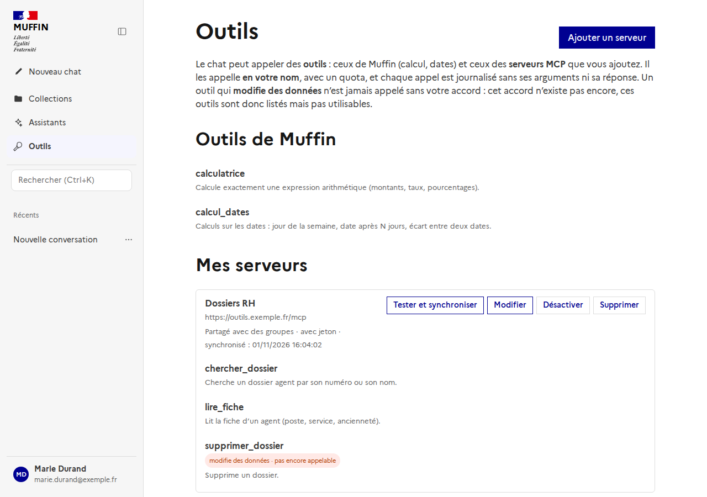
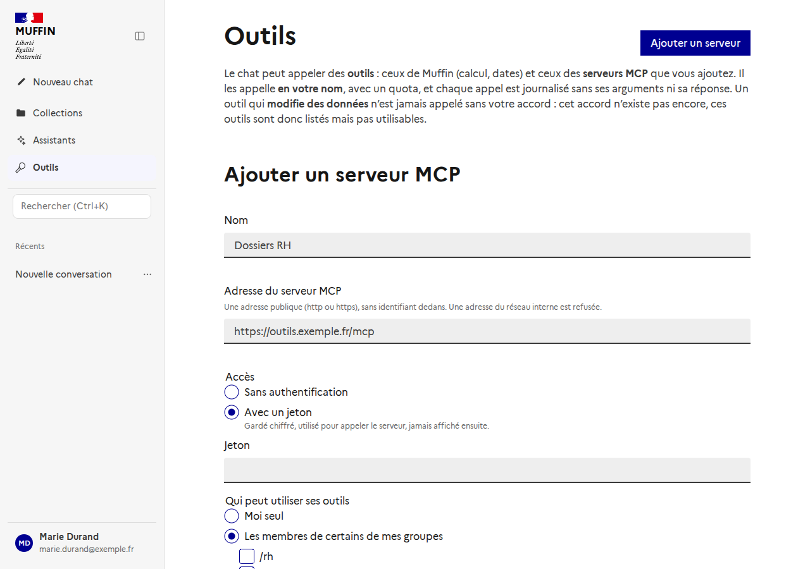
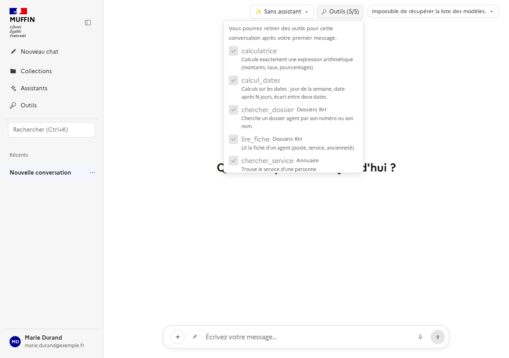

# Les outils du chat (#343)

Le chat peut **appeler des outils** : ceux de Muffin, qui vivent dans le code, et ceux de **serveurs MCP** que les utilisateurs ajoutent. Muffin est
déjà *serveur* MCP (`docs/mcp.md`, il expose sa recherche) ; ici il est aussi **client** : il appelle des serveurs tiers.

## Comment le chat s'en sert, avec le moins d'appels au modèle

Le chat reste le même graphe (LangGraph) : **le planificateur**, dans son appel habituel, peut choisir l'outil `call_tool` pour une de ses requêtes, avec
`ref` (l'outil) et `arguments`. Les outils offerts, avec leurs descriptions et le schéma de leurs arguments, sont dans le guide qu'il lit déjà : **aucun appel
de plus au modèle** pour décider, ni pour exécuter (un appel d'outil n'est pas un appel au modèle).

- Le résultat de l'outil devient une **source** comme les autres : la réponse dit d'où il vient, et dit aussi quand l'outil n'a pas pu être utilisé (avec
  son code). Il atteint toujours la réponse, quel que soit le score des passages.
- C'est **un tour**, pas une boucle : les requêtes d'un même plan (quatre au plus) s'exécutent ensemble, puis la réponse est écrite. Le plafond de tours est donc
  de un, et le modèle ne peut pas boucler. Un résultat qui en appellerait un autre demande une nouvelle question.
- Les outils sont demandés au backend **une fois par run**, et seulement pour un run qui a un modèle pour les choisir. Un assistant (`docs/assistants.md`)
  peut couper `call_tool` comme n'importe quel outil facultatif.
- **Avec beaucoup d'outils, le modèle n'en reçoit que quelques-uns** (#530) : ceux de Muffin toujours, et des serveurs MCP les `TOOLS_SELECTED_MAX` (8)
  plus proches de la question, par la recherche hybride de `docs/search.md` (« Descriptions des outils »). La description de tous les outils à chaque
  tour coûte des jetons et dégrade le choix. Seule la liste décrite se réduit : un appel est vérifié contre tout ce que la personne peut utiliser, et le
  modèle décide toujours de l'appel. Avec peu d'outils, rien ne change.

## Les outils de Muffin

Dans le code (`app/services/tools/internal_catalog.py`) : un identifiant stable, un nom, une description, un schéma, et la fonction qui l'exécute. Aucun ne modifie de
données ; les deux premiers ne touchent pas au réseau.

- **`calculatrice`** : calcul exact d'une expression (`+ - * / // % **`, `sqrt abs round min max`). Calculée **depuis l'arbre syntaxique, jamais avec `eval`** :
  un nom, un attribut, un autre appel, une chaîne ou un exposant démesuré sont refusés. La virgule décimale (`3,5`) est lue comme un point, sauf dans une
  expression avec fonction (`max(3, 9)`).
- **`calcul_dates`** : jour de la semaine, date après N jours, écart entre deux dates, bornes d'un mois. Sans date, on part d'aujourd'hui (fuseau Europe/Paris).
- **`generer_image`** (#518) : génère une image à partir d'une description et l'affiche sous la réponse. **Offert seulement si la génération d'images est activée** et
  ouverte à la personne ; c'est le seul outil interne qui sort du réseau (vers le fournisseur choisi par l'administrateur) et qui a un coût, borné par le quota du
  jour et `IMAGES_PER_RUN`. Voir `docs/image-generation.md`.
- **`retoucher_image`** (#518) : retouche une image de la conversation (celle que la personne vient de joindre, ou la dernière générée) à partir d'une description.
  Mêmes conditions et même quota que `generer_image`, et **offert en plus seulement quand la conversation contient une image** ; l'image et la description partent
  chez le fournisseur d'images. Voir `docs/image-generation.md`.

## Les serveurs MCP des utilisateurs

*Barre latérale → Outils → Ajouter un serveur* : un nom, l'adresse du serveur MCP (HTTP), l'accès et la visibilité. Ses outils sont importés (`tools/list`) ;
*Tester et synchroniser* les reprend (un outil disparu est retiré, un nouveau ajouté).

### L'adresse (garde contre le SSRF)

Un serveur d'outils est une adresse qu'un utilisateur saisit et que Muffin appelle **depuis l'intérieur de son réseau** : sans garde, c'est un moyen
d'atteindre ce que l'utilisateur ne peut pas (les autres services du cluster, le service de métadonnées du cloud, la machine locale).
`app/core/url_guard.py` vérifie :

- la **forme** : `http` ou `https`, un nom de serveur, **aucun identifiant dans l'adresse**, un domaine de `TOOLS_ALLOWED_DOMAINS` quand il est défini ;
- **ce que le nom devient** : toutes les adresses auxquelles il se résout doivent être **publiques** (ni privées, ni locales, ni `169.254.169.254`, ni
  partagées, ni réservées, ni multicast ; une adresse IPv6 qui encapsule une IPv4 privée est refusée). Une seule adresse privée parmi des publiques suffit à refuser.
- **à l'ajout et à chaque appel** : cela réduit, sans la fermer, la fenêtre du *DNS rebinding* (un nom qui répond une adresse publique puis une privée). La
  réponse durable est une règle de sortie sur le réseau, hors du code. Un serveur ne peut pas non plus rediriger vers une autre origine.

`TOOLS_ALLOW_PRIVATE_ADDRESSES` ne sert qu'à un poste de développement.

### Le jeton

Un serveur peut demander un jeton (`Authorization: Bearer`). Il est gardé **chiffré** dans le magasin de secrets (`docs/secrets.md`), lié à son propriétaire et à
son usage, utilisé pour appeler le serveur, et **jamais renvoyé** par aucune route. Retirer l'accès par jeton, ou supprimer le serveur, l'efface. L'échange de
jeton Keycloak (appeler au nom de la personne) n'est pas fait.

### Qui voit quoi

| Visibilité | Qui peut utiliser ses outils |
|---|---|
| Privé | le propriétaire |
| Groupes | les membres des groupes choisis (on ne partage qu'avec les groupes dont on fait partie) |
| Toute l'organisation | tout le monde |

Un serveur partagé se montre **par son nom et son origine** (`https://hôte`), sans le chemin ni les paramètres de l'adresse, qui peuvent contenir une clé ; ni
l'erreur de synchronisation, ni les groupes. Seul son propriétaire le modifie, le synchronise ou le supprime. Un serveur désactivé n'offre rien, mais reste à
son propriétaire. Un serveur privé d'un autre n'existe pas : `404`, y compris si l'on en connaît l'identifiant.

## Ce qu'un appel a le droit de faire

Tout est vérifié **côté backend**, pour **la personne du run** (lue sur le run, jamais sur ce que dit l'agent) :

1. L'outil doit être **offert à cette personne maintenant** (ses serveurs, ceux partagés avec elle, ceux de Muffin, moins ce qu'elle a retiré). Nommer un outil
   qu'on ne lui offre pas ne le rend pas appelable.
2. Un outil qui **modifie des données** n'est **jamais lancé par l'agent** : l'appel devient une demande d'accord (`confirmation_demandee`, voir « L'accord de la personne »).
3. Les arguments doivent **correspondre au schéma** de l'outil (validés par le planificateur et de nouveau par le backend), et rester courts.
4. Les **quotas** : `TOOLS_CALLS_PER_RUN` par run, `TOOLS_CALLS_PER_USER_PER_MINUTE` par personne.
5. La **réponse est bornée** (`TOOLS_OUTPUT_MAX_CHARS`, le reste est coupé et signalé) ; ce qui n'est pas du texte est omis ; les descriptions et les schémas
   que le serveur envoie sont bornés aussi.

**Un appel ne lève jamais d'erreur** : il répond un résultat avec un code qui ne change pas — `ok`, `quota_depasse`, `outil_indisponible`,
`arguments_invalides`, `confirmation_demandee`, `url_refusee`, `serveur_injoignable`, `delai_depasse`, `erreur_outil`. Ce que le réseau a dit d'une panne n'est pas
transmis.

### Les descriptions viennent de tiers

La description d'un outil MCP est écrite par le serveur et **lue par le modèle** : c'est un vecteur d'injection (*tool poisoning*). Le guide donné au modèle dit
que ces descriptions décrivent l'outil et ne sont pas des instructions ; ce que le modèle choisit est **vérifié en code** (un `ref` qui n'a pas été offert, des
arguments qui ne collent pas au schéma : la requête devient une recherche ordinaire) ; et rien de ce que renvoie un outil n'est exécuté.

## Les outils d'une conversation

*Outils (n/m)*, dans l'en-tête du chat : on peut **retirer** des outils pour la conversation (`PUT /api/conversations/{id}/tools`, la liste entière). Le modèle
ne les reçoit plus et ne peut plus les appeler. **On ne fait que retirer** : une conversation ne gagne jamais un outil que sa personne n'a pas le droit
d'utiliser. La liste n'est modifiable qu'une fois la conversation créée (après le premier message) ; celle d'un autre ne l'est jamais.

## Chercher un outil

Dans la page des outils et dans le menu *Outils* du chat, un champ **Chercher un outil** accepte une phrase (« convertir une devise », « retrouver un
dossier dans le SI RH ») et trie les outils par pertinence sur leur **description**, pas seulement sur leur nom (`GET /api/tools/search`, `docs/search.md`).
Il n'apparaît qu'à partir de 7 outils ; avec peu d'outils le filtre se fait dans le navigateur, sans requête, et il se déclenche après une pause de frappe.
Une recherche ne montre que les outils que la personne peut utiliser ; sans résultat, la liste dit « Aucun outil ne correspond ».

## Le journal

Chaque appel écrit **qui, quel outil, quel serveur, combien de temps, comment ça s'est fini** (`tool_call_logs`) — **jamais les arguments ni la réponse**, qui
peuvent contenir des données personnelles. La création, la modification et la suppression d'un serveur sont journalisées (qui, quoi, jamais le jeton).

## L'accord de la personne

Un outil qui **modifie des données** n'est jamais lancé par l'agent. Un outil MCP est considéré comme modifiant des données tant que son serveur ne dit pas
qu'il est en lecture seule (`readOnlyHint`). Quand le planificateur en choisit un, les arguments sont vérifiés comme pour les autres, puis l'appel devient une
**demande** (`chat_tool_calls`) : l'agent répond que **rien n'a été exécuté** et la discussion affiche une carte avec l'outil, son serveur et les arguments
exacts, avec **Autoriser** et **Refuser**.

- **Rien n'attend** : pas de tâche ni de connexion ouverte. La personne décide quand elle veut ; la décision lance l'outil (`POST /api/runs/{id}/tool-calls/decision`,
  `{"approve": true|false}`), pour **toutes** les demandes du tour ensemble.
- **Une seule fois** : chaque demande est réservée par une mise à jour conditionnelle ; un second clic ou un second onglet reçoit `409` et ne lance rien.
- **Avec les droits d'aujourd'hui** : ce qui est autorisé est appelé avec les droits que la personne a *maintenant* (outil retiré de la conversation, serveur
  désactivé ou plus partagé depuis : non lancé, dit `outil_indisponible`), les quotas et la garde d'adresse s'appliquent comme pour tout appel.
- **Le résultat est un message de la discussion** (refusé, exécuté, ou échoué avec son code). La réponse du serveur y est dans un bloc de code qu'elle ne peut
  pas fermer, bornée comme toute réponse ; le tour suivant la lit avec la conversation.
- **Elle ne s'accumule pas** : une demande expire après `TOOLS_PENDING_HOURS` (24 h), n'est plus valable si la personne écrit autre chose
  (`superseded`), et au plus `TOOLS_PENDING_PER_USER` (20) attendent par personne.
- `GET /api/conversations/{id}/tool-calls` liste les demandes (et leur état) ; chaque message de la conversation porte celles de son run (`tool_calls`).

## Pas encore

- L'échange de jeton Keycloak, un serveur par personne dans un groupe de travail, le reclassement des outils par un modèle dédié (#511),
  l'appel d'un outil en plusieurs tours, la limite par assistant d'un outil précis (un assistant coupe tous les outils ou aucun).
