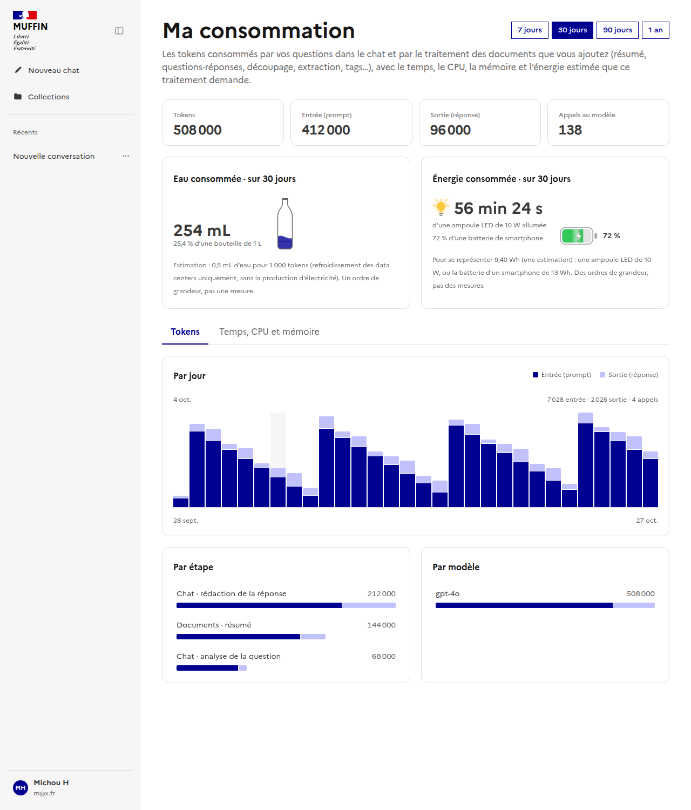
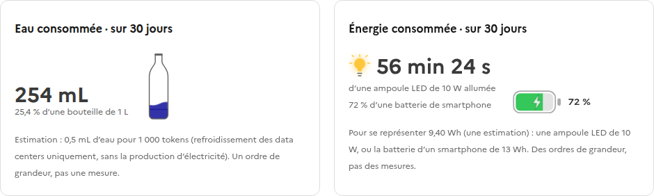
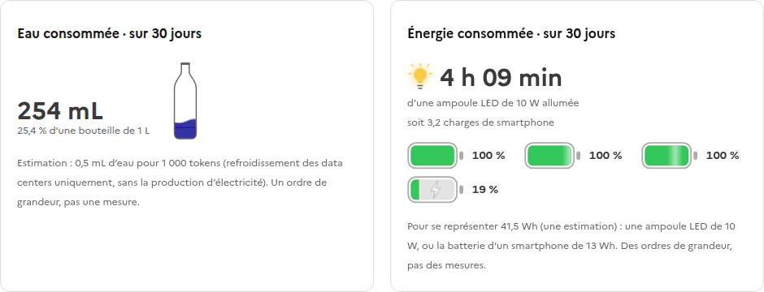
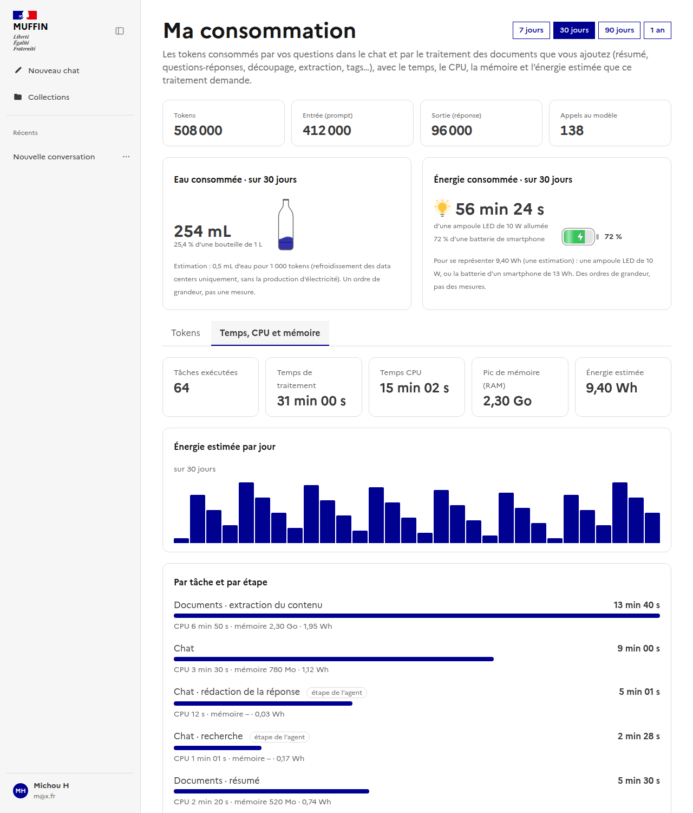

# Ma consommation — tokens, eau, temps de traitement et énergie

Page `/usage` (« Ma consommation ») et sa version administrateur `/admin/usage`. Elle montre ce que les
questions du chat et le traitement des documents ont consommé : les tokens des appels aux modèles, l'eau
qu'ils représentent, puis le temps, le CPU et la mémoire des tâches des workers, avec une énergie estimée.

Composants Vue : [`UsageView.vue`](../../../frontend/src/components/UsageView.vue),
[`AdminUsageView.vue`](../../../frontend/src/components/AdminUsageView.vue),
[`usage/UsageCharts.vue`](../../../frontend/src/components/usage/UsageCharts.vue),
[`usage/WaterBottles.vue`](../../../frontend/src/components/usage/WaterBottles.vue),
[`usage/EnergyBatteries.vue`](../../../frontend/src/components/usage/EnergyBatteries.vue),
[`usage/ExecutionPanel.vue`](../../../frontend/src/components/usage/ExecutionPanel.vue).
Composable : [`useUsage.ts`](../../../frontend/src/composables/useUsage.ts) - lit `GET /api/usage/me`
(`GET /api/admin/usage` côté administrateur), un seul appel pour toute la page.

## Disposition

Sous les tuiles de tokens, deux cartes côte à côte : l'**eau** (calculée à partir des tokens) et l'**énergie**
(calculée à partir du CPU et de la mémoire des workers). Elles couvrent deux périmètres différents et ne se
comptent pas deux fois. Dessous, deux onglets : **Tokens** (par jour, par étape, par modèle) et **Temps, CPU et
mémoire** (le détail des tâches). Ce second onglet n'apparaît que s'il existe des tâches enregistrées.

## L'énergie, en ampoule et en batterie

Le chiffre principal est le temps pendant lequel une ampoule LED de 10 W resterait allumée avec cette énergie.
En dessous, une batterie de smartphone (13 Wh) se charge comme sur un iPhone : un remplissage vert, un éclair
et un reflet qui parcourt la charge. Au-delà d'une charge complète, les batteries se remplissent l'une après
l'autre (six au plus, puis « + N »). Les animations sont coupées si le navigateur demande de réduire les
mouvements.

Ce sont des ordres de grandeur pour se représenter une énergie, pas des mesures.

## Temps, CPU, mémoire et énergie estimée

Chaque tâche d'un worker (le run de l'agent, le traitement d'un document, un résumé…) envoie, quand elle se
termine, sa durée, son temps CPU et son pic de mémoire. L'agent envoie aussi, pour chacun de ses nœuds, sa
durée et son CPU : ces « étapes de l'agent » détaillent le temps d'une tâche et ne s'ajoutent pas à ses totaux.
Une tâche qui partage son processus avec d'autres (un pool de threads) rapporte le CPU de son propre thread et
une part de la mémoire.

L'énergie est **estimée**, jamais mesurée : (temps CPU × puissance d'un cœur + mémoire occupée × durée ×
puissance par Go) × PUE du centre de données. Les facteurs se règlent par `ENERGY_WATTS_PER_CORE`,
`ENERGY_WATTS_PER_GB` et `ENERGY_PUE` (voir [environment-variables.md](../../environment-variables.md)) et
s'appliquent à l'historique, car l'énergie est calculée à la lecture. Elle ne comprend pas l'inférence des
modèles de langage, qui tourne ailleurs ; la page le rappelle.
